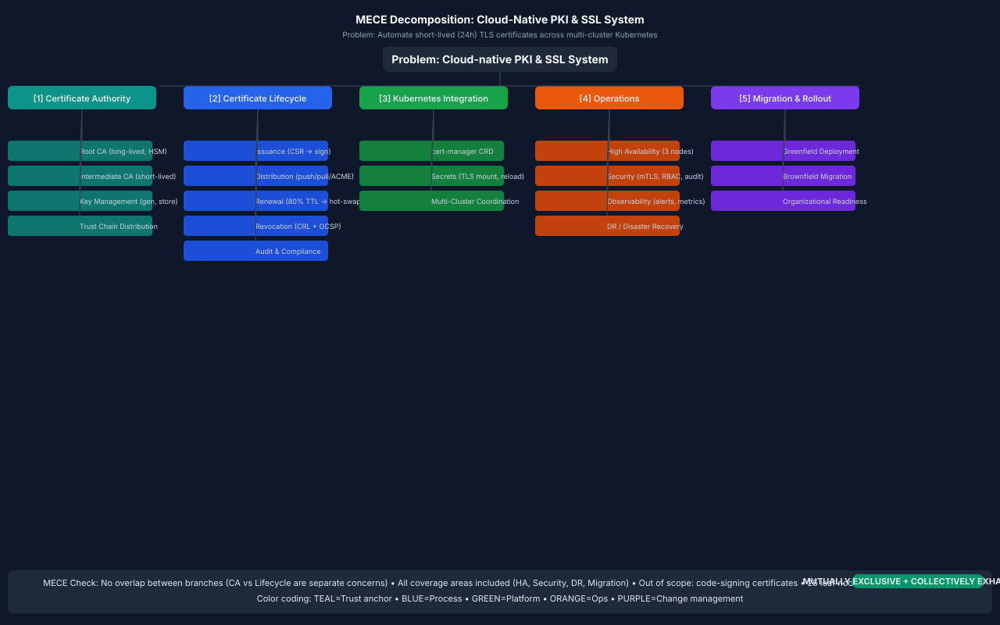

# MECE Decomposition

A structured problem-solving skill for breaking complex problems,
analyses, product features, and requirements into
**Mutually Exclusive, Collectively Exhaustive** (MECE) structures,
including actionable user stories.

[](https://opencode.ai)
[](LICENSE)
[](https://agentskills.io)

> "Structured thinkers are trained, not born. MECE is analytical
> thinking with a name and a checklist."

## Table of Contents

- [What is MECE?](#what-is-mece)
- [How this skill works](#how-this-skill-works)
- [Five splitting lenses](#five-splitting-lenses)
- [Why use this skill?](#why-use-this-skill)
- [Installation](#installation)
- [Usage examples](#usage-examples)
- [Example decompositions](#example-decompositions)
- [Cross-platform compatibility](#cross-platform-compatibility)
- [References](#references)

---

## What is MECE?

MECE stands for **Mutually Exclusive, Collectively Exhaustive** —
a problem-structuring principle that ensures categories do not overlap
and together cover the full scope.

### Two constraints

| Constraint | Meaning | Consequence of violation |
|---|---|---|
| **Mutually Exclusive** | Each item belongs to exactly one category | Double-counting, conflicting assignments |
| **Collectively Exhaustive** | The categories cover all possibilities | Missing items, blind spots |

### Origin

MECE was developed by **Barbara Minto** at McKinsey & Company in the
late 1960s, alongside the **Pyramid Principle** for structured
communication. Minto joined McKinsey in 1963 and codified MECE as a
constraint on how problems may be divided — a discipline that has
survived six decades of business-fad cycles.

> "Sixty years is a long shelf life for a business idea. MECE
> outlasted the fads because it isn't really a framework, it's a
> constraint on how you're allowed to divide a problem, and that
> constraint doesn't age."
> — *Scaler Blog, "MECE Framework: The Thinking System Behind Every
> McKinsey Answer"*

### Why it matters in the AI era

AI is extraordinary at filling in a branch once you've defined it.
It is not yet good at deciding which branches should exist. Only a
MECE decomposition guarantees the analysis is complete and
non-redundant.

## How this skill works

This skill gives an AI agent a structured, repeatable process for
decomposing any problem into MECE parts. The workflow has six steps:

```
1. Clarify   → Concrete question, scope, constraints, assumptions
2. Lens      → Pick one splitting dimension (formula, process, …)
3. Build     → Decompose each branch only if needed
4. MECE check → Find overlaps, gaps, edge cases
5. Act       → Attach research, decision, task, or user story
6. Uncertainty → Surface assumptions, open questions, recommendations
```

The skill includes a built-in **quality checklist** that runs before
every delivery.

## Five splitting lenses

Each lens is designed so that its branches are MECE by construction.
Pick one per decomposition level.

| Lens | When to use | Example |
|---|---|---|
| **Formula** | The problem has a mathematical or logical structure | Revenue = Price × Volume; Profit = Revenue − Costs |
| **Process** | The problem follows a sequence or lifecycle | Discovery → Onboarding → Active Use → Retention → Churn |
| **Components** | The problem can be split by structural parts | Frontend / Backend / Database; Presentation / Business Logic / Data |
| **Stakeholders** | The problem behaves differently for user groups | New users vs. Existing; Admin vs. Regular user |
| **Opposites** | A binary split captures the core tension | Fixed vs. Variable; Build vs. Buy vs. Borrow |

Choosing the wrong lens is the single most common way to wreck an
issue tree — it produces a structure that looks clean but reads like
nonsense.

## Why use this skill?

- **No overlapping work.** Every category has one unique home —
  two teams working on different branches never produce conflicting
  results.
- **No blind spots.** Every plausible case fits into a branch —
  a client asking "but what about X?" is answered before the
  presentation.
- **Structured AI interaction.** AI fills branches excellently but
  cannot yet decide which branches should exist. MECE puts human
  structure first and AI horsepower second.
- **Reusable across domains.** Problem trees, product backlogs,
  feature decomposition, user stories, root-cause analysis —
  the same six-step process applies everywhere.
- **Cross-platform.** This skill follows the open Agent Skills
  standard and works across multiple AI coding tools.

## Installation

### Global via Git symlink (recommended)

```bash
# Clone to a fixed location
git clone git@github.com:petervirtech/mece-skill.git ~/dev/mece-skill
mkdir -p ~/.config/opencode/skills

# Symlink (use -sfn to replace existing)
ln -sfn ~/dev/mece-skill/.opencode/skills/mece \
  ~/.config/opencode/skills/mece
```

The symlink lets OpenCode discover the skill while Git remains the
single source of truth. To update:

```bash
cd ~/dev/mece-skill
git pull
```

### Team-wide distribution

```bash
# On each team member's machine:
git clone git@github.com:<org>/platform-skills.git ~/dev/platform-skills

# Symlink individual skills:
ln -sfn ~/dev/platform-skills/skills/cloudstack-troubleshooting \
  ~/.config/opencode/skills/cloudstack-troubleshooting
ln -sfn ~/dev/platform-skills/skills/k8s-platform-standards \
  ~/.config/opencode/skills/k8s-platform-standards
```

Improvements go through normal Git PRs; after merge and `git pull`
everyone sees the updated skill.

### Verify installation

Restart OpenCode (or your agent).  The skill appears in the
available skills list with:

- **ID:** `mece`
- **Name:** MECE decomposition
- **Description:** "Decompose problems, analyses, product features,
  and requirements into mutually exclusive and collectively exhaustive
  (MECE) structures …"

## Usage examples

> Break down the problem "user onboarding takes too long" using MECE.
> Name assumptions, check for overlaps, and make the result actionable.

> Translate this feature into a MECE set of user stories with
> Given/When/Then acceptance criteria, covering happy paths, error
> paths, and edge cases.

> I need to structure the root-cause analysis for rising churn.  Use
> MECE.

> Validate this backlog structure for gaps or overlaps.

## Example decompositions

See `.opencode/skills/mece/references/examples.md` for full worked-out
decompositions:

- **Revenue decline** (formula lens)
- **Rising operational costs** (formula + components lens)
- **User churn** (process + stakeholder lens)
- **Self-serve dashboard** (feature → user stories)
- **Cloud-native PKI & SSL** (components + process, 5 main branches,
  25+ leaf nodes)
- **IaC CI/CD Pipeline** (process + components)
- **Multi-tenant secrets management** (stakeholders + process)

### Example: PKI & SSL decomposition



Full analysis with MECE check, prioritisation table, assumptions, and
open questions is available in the `examples.md` file.

## Cross-platform compatibility

This skill follows the [Agent Skills](https://agentskills.io) open
standard, so it works in:

- OpenCode
- Claude Code
- Cursor
- VS Code (with GitHub Copilot)
- Gemini CLI
- OpenAI Codex
- Goose (Block)
- Amp, Factory, Letta

## References

### Books

1. **Minto, Barbara.** *The Pyramid Principle: Logic Writing in
   Consulting and Business.* 3rd ed., Financial Times Prentice Hall,
   2010. (Original concept: 1973.)
   The source of MECE and the Pyramid Principle.

2. **Christensen, Clayton R., Paul Willmard, and George S. Dyerson.**
   *The McKinsey Way: A Guide to Management Consulting's Most
   Powerful Problem-Solving Tools.* McGraw-Hill, 1995.
   Accessible introduction to MECE issue trees.

3. **Cheng, Victor.** *Case Interview Secrets.* CreateSpace, 2013.
   Practical MECE practice with real case examples.

### Articles and guides

4. **Scaler Blog.** "MECE Framework: The Thinking System Behind Every
   McKinsey Answer (and How Leaders Master It)."
   <https://scaler.com/blog/mece-framework-the-thinking-system-behind-every-mckinsey>

5. **MBA Crystal Ball.** "MECE Framework McKinsey."
   <https://www.mbacrystalball.com/blog/strategy/mece-framework/>

6. **CaseInterview.com.** "MECE Framework / Principle — What does it
   mean? Why do consultants find it useful?"
   <https://caseinterview.com/mece>

7. **Minto, Barbara.** "A Background on MECE." Blog post, 2011.
   <https://www.builtinchi.com/mcKinsey/mece-principle>

8. **Anthropic Engineering.** "Equipping Agents for the Real World
   with Agent Skills."
   <https://www.anthropic.com/engineering/equipping-agents-for-the-real-world-with-agent-skills>

### Standards

9. **Agent Skills Specification.** Open standard for agent skills.
   <https://agentskills.io/specification.md>

10. **OpenCode Documentation.** Skills, discovery, and distribution.
    <https://opencode.ai/docs/skills>

## License

Apache License 2.0 — see [LICENSE](LICENSE).
